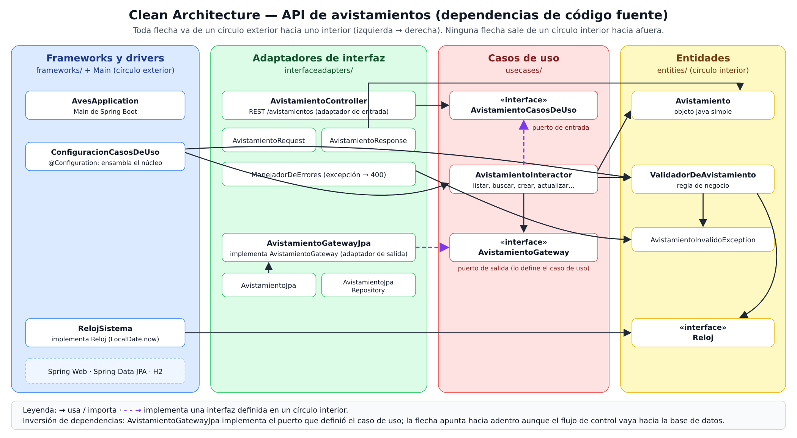
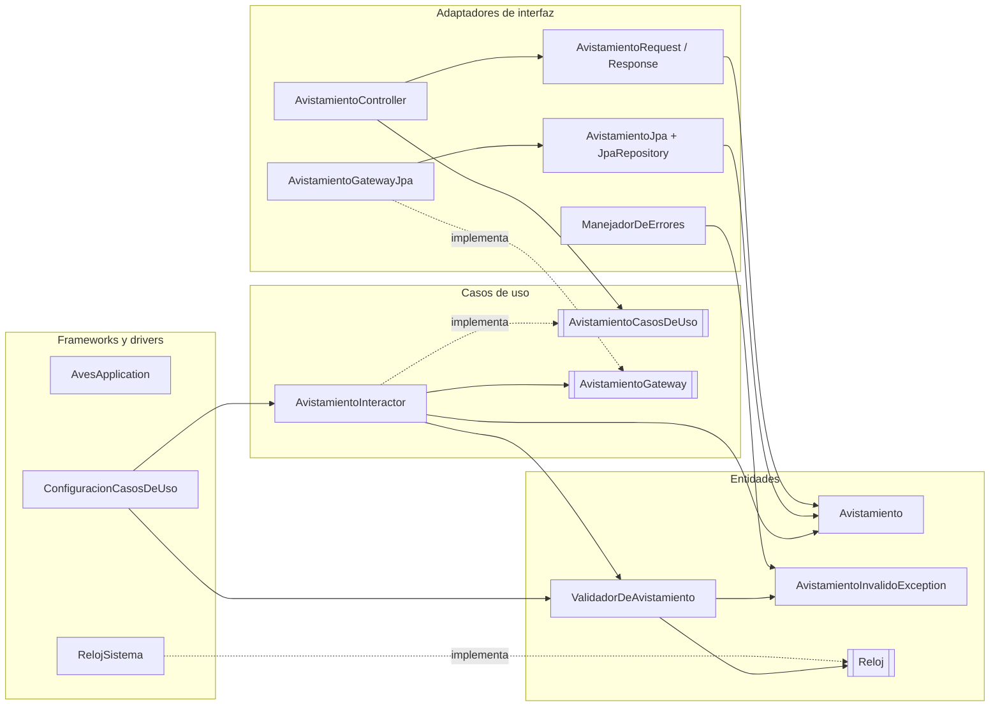
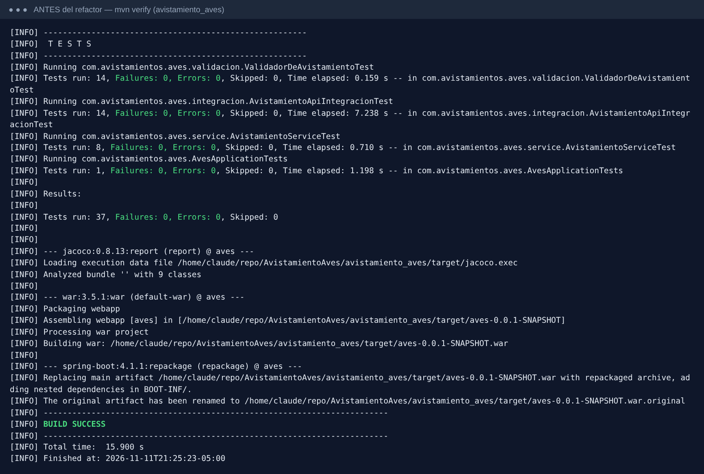
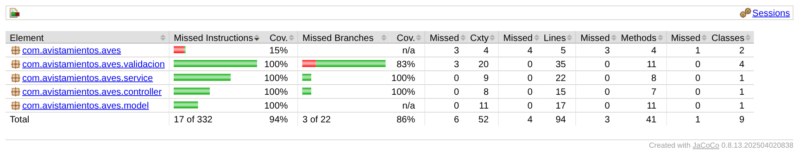
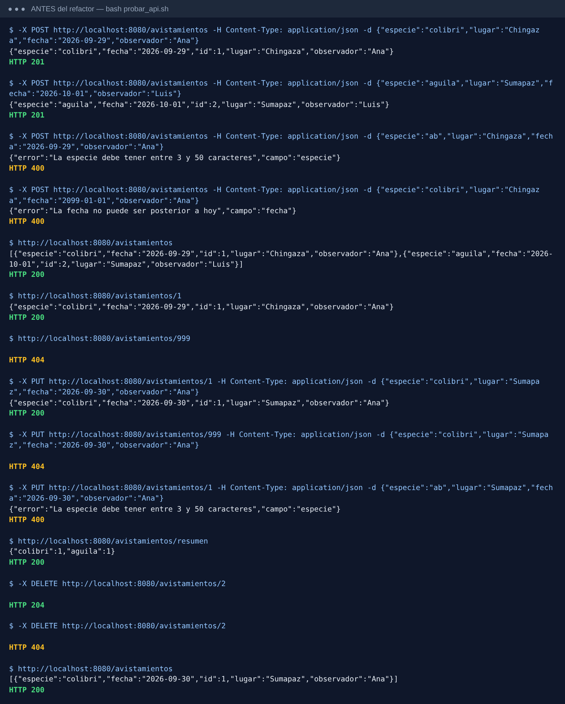
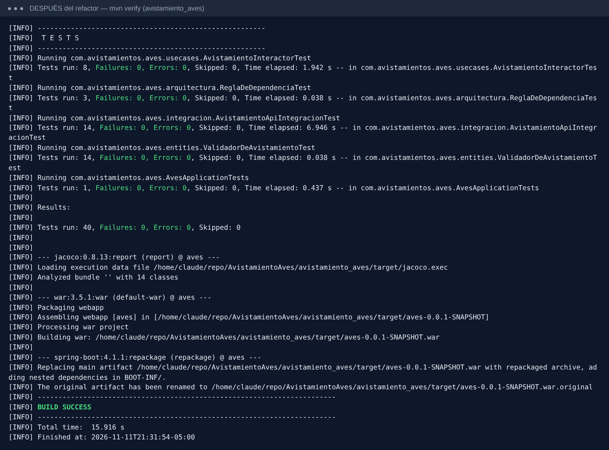
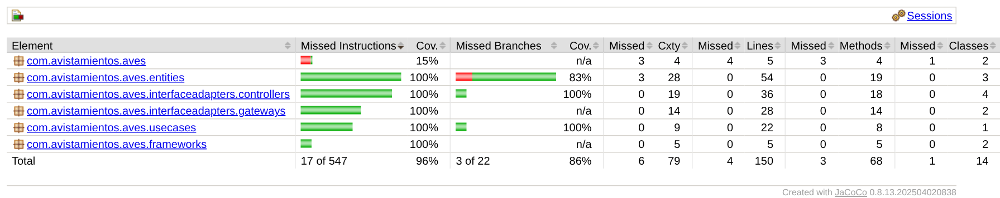
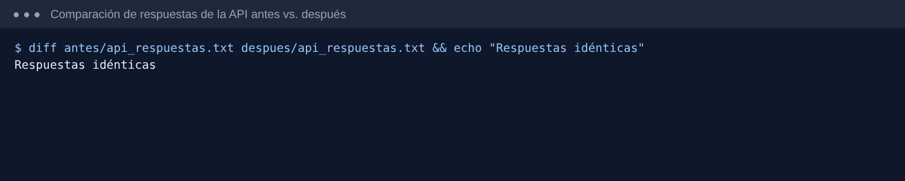

# Taller 5: Clean Architecture y arquitectura hexagonal

**Ingeniería de Software 2 (ISW-2)** · Miércoles 11 de noviembre de 2026  
**Autor:** Juan David Guarnizo Martinez

- **Repositorio:** https://github.com/Juanda210809/AvistamientoAves
- **Rama con los cambios:** `taller5-clean-architecture`
  (https://github.com/Juanda210809/AvistamientoAves/tree/taller5-clean-architecture)
- **Arquitectura elegida:** Clean Architecture (Martin, 2012)

---

## Parte 1. Investigación

### 1. El problema de Cockburn, puertos, adaptadores y la simetría

**El problema.** Cockburn parte de algo que veía en muchas aplicaciones: la lógica de negocio se termina metiendo dentro del código de la interfaz de usuario. Cuando eso pasa salen tres problemas: no se pueden escribir pruebas automáticas fáciles, porque la lógica queda mezclada con detalles visuales que cambian todo el tiempo; no se puede pasar a ejecutar la aplicación por lotes (sin una persona delante); y es difícil que otro programa la use (Cockburn, 2005). Él agrega que el mismo problema aparece del lado de la base de datos: si la base no está disponible o se cambia, el desarrollo se frena, porque la lógica también está enredada con ella (Cockburn, 2005). También dice que meter una capa más no lo arregla, porque nada impide que la lógica se vuelva a filtrar en esa capa nueva (Cockburn, 2005).

**Puerto.** Un puerto es un punto de entrada o salida de la aplicación definido por el *propósito* de la conversación, no por la tecnología. En la práctica es una API (una interfaz) que la aplicación expone o que la aplicación necesita (Cockburn, 2005). Por ejemplo, "registrar un avistamiento" o "guardar y consultar avistamientos".

**Adaptador.** Un adaptador es la pieza que conecta una tecnología concreta con un puerto y traduce entre las dos. Para un mismo puerto puede haber varios adaptadores: del lado del usuario, una interfaz gráfica, un arnés de pruebas automáticas o un script por lotes; del lado de los datos, un adaptador SQL, uno de archivos planos o uno en memoria (un *mock*) para pruebas (Cockburn, 2005). Cockburn muestra esto con un ejemplo de descuentos donde el repositorio de tasas se reemplaza por uno en memoria y el componente recibe ese repositorio por el constructor, así se prueba sin interfaz ni base de datos (Cockburn, 2005).

**La simetría.** Cockburn dice que la diferencia importante no es "izquierda contra derecha" ni "arriba contra abajo" como en las capas, sino **adentro contra afuera**: hay una aplicación en el centro que se comunica por varios puertos con cosas de afuera (Cockburn, 2005). Desde ese punto de vista, el usuario que maneja la aplicación y la base de datos que la aplicación usa son lo mismo: actores externos conectados por un puerto y un adaptador. La única diferencia es quién inicia la conversación: los actores *primarios* (usuario, pruebas, scripts) manejan la aplicación, y los *secundarios* (base de datos, servicios de notificación) son manejados por ella (Cockburn, 2005). Por eso la figura es un hexágono y no capas apiladas: el número seis no importa, la forma solo deja espacio para dibujar los puertos que se necesiten a cualquier lado (Cockburn, 2005).

### 2. Los círculos de Clean Architecture y la regla de dependencia

Martin dibuja cuatro círculos concéntricos (Martin, 2012):

| Círculo (de adentro hacia afuera) | Qué va ahí |
|---|---|
| **Entidades** | Las reglas de negocio de la empresa, las más generales. Pueden ser objetos con métodos o estructuras de datos con funciones. Son lo que menos cambia y no se ven afectadas por cambios de pantallas o de seguridad. |
| **Casos de uso** | Las reglas propias de *esta* aplicación. Coordinan el flujo de datos hacia y desde las entidades y les piden que apliquen sus reglas. Cambian cuando cambia lo que hace la aplicación, no cuando cambia la base de datos o la interfaz. |
| **Adaptadores de interfaz** | Convierten los datos del formato que les sirve a los casos de uso y entidades al formato que le sirve a lo externo (web, base de datos). Aquí van los controladores, presentadores y vistas (MVC), y la conversión hacia la persistencia. |
| **Frameworks y drivers** | Lo más externo: la base de datos, el framework web y otras herramientas. Casi no hay código propio, solo "pegamento" que conecta con el círculo siguiente. |

Martin aclara que los cuatro círculos son un esquema: puede haber más o menos, siempre que se cumpla la regla, y que mientras más adentro, más abstracto y de más alto nivel es el código (Martin, 2012).

**La regla de dependencia (The Dependency Rule).** Dice que **las dependencias de código fuente solo pueden apuntar hacia adentro** (Martin, 2012). Lo que prohíbe: que algo de un círculo interior *nombre* cualquier cosa de un círculo exterior, sea una clase, una función, una variable o cualquier otro elemento con nombre. También prohíbe que el círculo interior use formatos de datos definidos afuera, sobre todo los que genera un framework, para que un cambio afuera no obligue a cambiar adentro (Martin, 2012). En resumen: la entidad no sabe que existe el caso de uso, el caso de uso no sabe que existe el controlador, y ninguno sabe que existe Spring o H2.

### 3. Cómo el caso de uso guarda datos sin depender de la base de datos

La contradicción es real: en tiempo de ejecución el control va **hacia afuera** (el caso de uso termina provocando una escritura en la base), pero la regla dice que el código solo puede depender **hacia adentro**. Martin lo resuelve con el **principio de inversión de dependencias**: el círculo interior declara una interfaz con lo que necesita, y el círculo exterior la implementa. Así la flecha de dependencia del código queda al revés del flujo de control (Martin, 2012). Él lo explica con el caso de uso que tiene que mostrar resultados: el caso de uso no llama directamente al presentador, sino a una interfaz (un puerto de salida) que vive en el círculo de casos de uso, y el presentador de afuera la implementa (Martin, 2012). Con la persistencia es exactamente igual. Es lo mismo que vimos de SOLID: los módulos de alto nivel no dependen de los de bajo nivel, ambos dependen de abstracciones. Palermo describe el mismo mecanismo: las interfaces de repositorio se definen en el núcleo y sus implementaciones están en el borde, y se inyectan en tiempo de ejecución (Palermo, 2008).

**Ejemplo con mi API (así quedó el código):**

```java
// Círculo de casos de uso: el caso de uso DEFINE lo que necesita.
package com.avistamientos.aves.usecases;
public interface AvistamientoGateway {
    Avistamiento guardar(Avistamiento avistamiento);
    Optional<Avistamiento> buscarPorId(Long id);
    // ...
}

public class AvistamientoInteractor implements AvistamientoCasosDeUso {
    private final AvistamientoGateway gateway;          // depende de la interfaz
    public Avistamiento crear(Avistamiento a) {
        validador.validar(a);
        a.setId(null);
        return gateway.guardar(a);                      // no sabe que hay JPA
    }
}

// Círculo de adaptadores: la IMPLEMENTA usando Spring Data JPA.
package com.avistamientos.aves.interfaceadapters.gateways;
@Component
public class AvistamientoGatewayJpa implements AvistamientoGateway {
    private final AvistamientoJpaRepository repo;
    public Avistamiento guardar(Avistamiento a) {
        return repo.save(AvistamientoJpa.desdeDominio(a)).haciaDominio();
    }
}
```

El flujo de control es `Interactor → Gateway → GatewayJpa → base de datos`, pero en el código `AvistamientoGatewayJpa` importa `usecases.AvistamientoGateway`, y `usecases` no importa nada de `interfaceadapters`. Spring es quien, al arrancar, le pasa al interactor la implementación concreta. Además, como pide Martin, lo que cruza la frontera es la entidad simple `Avistamiento`, no la fila de JPA (`AvistamientoJpa`), porque si la fila llegara al caso de uso, este quedaría dependiendo del framework de persistencia (Martin, 2012).

### 4. Comparación: hexagonal, cebolla y Clean Architecture

**Lo que tienen en común.** Las tres ponen la lógica del negocio en el centro y empujan la tecnología (interfaz, base de datos, frameworks) al borde, como algo intercambiable. Las tres logran eso con interfaces definidas por el núcleo e implementadas afuera, es decir, con inversión de dependencias (Cockburn, 2005; Palermo, 2008; Martin, 2012). Las tres buscan lo mismo: poder probar la lógica sin la interfaz ni la base de datos y poder cambiar esos detalles sin tocar el negocio. Martin mismo dice que su artículo es un intento de juntar en una sola idea varias arquitecturas, entre ellas la hexagonal y la de cebolla, y que aunque cambian en los detalles son muy parecidas (Martin, 2012). Palermo también reconoce que comparte la premisa de Cockburn de sacar la infraestructura y conectarla con adaptadores (Palermo, 2008).

**Lo que cambia:**

| | Hexagonal (Cockburn, 2005) | Cebolla (Palermo, 2008) | Clean Architecture (Martin, 2012) |
|---|---|---|---|
| Idea central | Adentro vs. afuera, conectados por puertos | Anillos concéntricos; el acoplamiento va hacia el centro | Círculos concéntricos + una sola regla de dependencia |
| Capas | **No define capas internas.** Solo "la aplicación" y lo de afuera | Modelo de dominio al centro, luego servicios de dominio y de aplicación; afuera UI, infraestructura y pruebas. El número de anillos puede variar | Cuatro círculos con nombre (entidades, casos de uso, adaptadores, frameworks), "esquemáticos" |
| Vocabulario | Puerto, adaptador, actor primario/secundario | Modelo de dominio, interfaz de repositorio, servicios, infraestructura | Entidad, caso de uso / *interactor*, puerto de entrada/salida, *gateway*, controlador, presentador |
| Énfasis | La **simetría**: el usuario y la base de datos se tratan igual; las pruebas como un actor más | La **base de datos no es el centro**: se trata como algo externo; muy orientada a objetos y a DDD | La **dirección de las dependencias** en todo el sistema y qué datos cruzan las fronteras |
| Organización interna del núcleo | No dice nada | Distingue dominio de servicios | Distingue reglas de empresa (entidades) de reglas de la aplicación (casos de uso) |

En resumen, para mí el cambio no es solo de vocabulario: la hexagonal habla de la **frontera** de la aplicación y no dice cómo organizar el interior (Cockburn, 2005); la cebolla y Clean sí proponen capas dentro del núcleo (Palermo, 2008; Martin, 2012). Clean además convierte todo en una sola regla verificable (las dependencias apuntan hacia adentro) y agrega la separación entre reglas de empresa y reglas de la aplicación, más la pregunta de qué formato de datos puede cruzar cada frontera (Martin, 2012).

### 5. ¿Se justifica Clean Architecture en una API tan pequeña?

**Mi posición:** para esta API, tal como está hoy, **no se justifica aplicarla completa como si fuera un sistema grande**, pero **sí se justifica la parte central**: tener el núcleo (validador, entidad y casos de uso) sin Spring ni JPA, y que el caso de uso dependa de una interfaz de repositorio definida por él mismo. Lo apliqué completo porque el taller lo pide, y eso me dejó ver bien los costos.

**Costo concreto (trade-off).** El código de producción pasó de 11 a 18 clases para la misma funcionalidad. Ahora el mismo avistamiento existe en cuatro formas: `AvistamientoRequest` (JSON de entrada), `Avistamiento` (dominio), `AvistamientoJpa` (fila de la base) y `AvistamientoResponse` (JSON de salida), con código de conversión entre ellas (`haciaDominio`, `desdeDominio`, `desde`). Si mañana agrego un campo, por ejemplo "cantidad de aves", tengo que tocar cinco archivos en lugar de uno. Palermo lo dice directamente: su arquitectura es apropiada para aplicaciones de negocio de larga vida y con comportamiento complejo, y no para sitios web pequeños (Palermo, 2008). Mi API tiene 6 endpoints y una regla de validación, así que entra más en el segundo grupo.

**Beneficio concreto.** El caso de uso ya no conoce `JpaRepository`. Antes, la prueba unitaria del servicio tenía que simular métodos de Spring Data (`findById`, `existsById`, `save`); ahora simula `AvistamientoGateway`, una interfaz de cinco métodos con nombres del dominio que yo controlo. Eso es justo lo que buscan Cockburn y Martin: que la lógica se pueda probar aislada de la base de datos y del framework web (Cockburn, 2005; Martin, 2012). También puedo cambiar H2 por PostgreSQL, o JPA por JDBC, escribiendo un adaptador nuevo sin tocar el interactor ni el validador. Y como la regla de dependencia es mecánica, la pude convertir en una prueba (`ReglaDeDependenciaTest`) que falla si alguien importa Spring desde las entidades o los casos de uso.

**Conclusión:** el beneficio que más vale (núcleo sin framework y repositorio como puerto) es barato; lo caro son los DTO y los mapeos en cada frontera. En una API de este tamaño yo me quedaría con lo primero y dejaría lo segundo para cuando la API crezca o tenga más de un cliente. Si la API fuera a vivir años o a crecer en reglas, el costo inicial se paga solo.

---

## Parte 2. Aplicación

### Arquitectura elegida

Elegí **Clean Architecture (Martin, 2012)**. Los paquetes tienen el nombre de los cuatro círculos de Martin y las clases usan su vocabulario (entidad, interactor, puerto de entrada, *gateway*, controlador). No usé nombres de las otras dos (no hay paquetes `ports`/`adapters` ni `domain`/`infrastructure`) para no mezclar.

### Estructura de carpetas

Antes (organizado alrededor del framework):

```
com.avistamientos.aves
├── AvesApplication.java, ServletInitializer.java
├── model/Avistamiento.java            @Entity de JPA, usado también como JSON
├── validacion/                        Validador, Reloj, RelojSistema, excepción, manejador 400
├── repository/AvistamientoRepository  JpaRepository
├── service/AvistamientoService        @Service, dependía de JpaRepository
└── controller/AvistamientoController  @RestController
```

Después (Clean Architecture):

```
avistamiento_aves/src/main/java/com/avistamientos/aves
├── AvesApplication.java                 Main (círculo de frameworks y drivers)
├── ServletInitializer.java              Main para desplegar el .war
│
├── entities/                            ── Círculo 1: ENTIDADES (reglas de negocio)
│   ├── Avistamiento.java                   objeto Java simple, sin JPA ni Spring
│   ├── ValidadorDeAvistamiento.java        regla: especie 3-50, fecha válida y no futura, campos obligatorios
│   ├── AvistamientoInvalidoException.java
│   └── Reloj.java                          interfaz: "qué día es hoy"
│
├── usecases/                            ── Círculo 2: CASOS DE USO
│   ├── AvistamientoCasosDeUso.java         puerto de entrada (interfaz que usa el controlador)
│   ├── AvistamientoInteractor.java         implementa los casos de uso: listar, buscar, crear, actualizar, eliminar, resumen
│   └── AvistamientoGateway.java            puerto de salida (interfaz de persistencia definida aquí)
│
├── interfaceadapters/                   ── Círculo 3: ADAPTADORES DE INTERFAZ
│   ├── controllers/
│   │   ├── AvistamientoController.java     REST /avistamientos → llama al puerto de entrada
│   │   ├── AvistamientoRequest.java        JSON de entrada → entidad
│   │   ├── AvistamientoResponse.java       entidad → JSON de salida
│   │   └── ManejadorDeErrores.java         AvistamientoInvalidoException → 400 {"campo","error"}
│   └── gateways/
│       ├── AvistamientoGatewayJpa.java     implementa AvistamientoGateway
│       ├── AvistamientoJpa.java            @Entity (fila de la tabla "avistamiento") + conversión
│       └── AvistamientoJpaRepository.java  Spring Data
│
└── frameworks/                          ── Círculo 4: FRAMEWORKS Y DRIVERS
    ├── ConfiguracionCasosDeUso.java        @Configuration: crea el validador y el interactor
    └── RelojSistema.java                   implementa Reloj con LocalDate.now()

src/test/java/com/avistamientos/aves
├── entities/ValidadorDeAvistamientoTest.java, RelojFijo.java     unitarias (14)
├── usecases/AvistamientoInteractorTest.java                      unitarias con Mockito (8)
├── integracion/AvistamientoApiIntegracionTest.java               integración MockMvc + H2 (14)
├── arquitectura/ReglaDeDependenciaTest.java                      verifica la regla de dependencia (3, nueva)
└── AvesApplicationTests.java                                     contexto de Spring (1)
```

Decisiones que tomé:

- **Entidades y casos de uso no tienen ninguna anotación de Spring.** Antes `ValidadorDeAvistamiento` era `@Component` y el servicio `@Service`; ahora se crean en `frameworks/ConfiguracionCasosDeUso`, que es el único lugar que conoce a la vez el núcleo y sus implementaciones (el "Main" de Martin).
- **`Reloj` quedó en entidades** porque lo necesita la regla de la fecha, que es una regla de negocio. Su implementación con el reloj del sistema (`RelojSistema`) es un detalle y quedó afuera.
- **La entidad de dominio y la de JPA están separadas.** `AvistamientoJpa` conserva el nombre de tabla `avistamiento` con `@Table`, para no perder los datos que ya había en `data/`.
- **Spring Web y Spring Data se usan solo en los adaptadores** como herramientas para el pegamento (anotaciones `@RestController`, `JpaRepository`), y la regla de dependencia se cumple entre mis propios círculos: `interfaceadapters` no importa nada de `frameworks`, `usecases` solo importa `entities`, y `entities` solo importa `java.time`.

### Diagrama de dependencias



La misma idea en Mermaid (GitHub lo dibuja):



Comprobación con `grep` de lo que importa cada círculo (después del refactor):

```
== entities importa:          java.time, java.time.format
== usecases importa:          com.avistamientos.aves.entities, java.util, java.util.stream
== interfaceadapters importa: com.avistamientos.aves.entities, com.avistamientos.aves.usecases,
                              jakarta.persistence, java.util, org.springframework.(data|http|stereotype|web)
== frameworks importa:        com.avistamientos.aves.entities, com.avistamientos.aves.usecases,
                              java.time, org.springframework.(context|stereotype)
```

### Commits del refactor

| Commit | Qué hace |
|---|---|
| `Taller 5: guarda evidencia ... antes del refactor` | Salida de las pruebas, reporte JaCoCo y respuestas de la API del código original. |
| `Refactor 1/5` | Mueve las reglas de negocio (validador, `Reloj`, excepción) a `entities`; `RelojSistema` a `frameworks`; `ManejadorDeErrores` a `interfaceadapters/controllers`. |
| `Refactor 2/5` | Crea los casos de uso: `AvistamientoInteractor` (antes `AvistamientoService`), el puerto de entrada, el puerto de salida `AvistamientoGateway`, su adaptador JPA y la configuración que ensambla todo. |
| `Refactor 3/5` | Separa `entities/Avistamiento` (objeto simple) de `AvistamientoJpa` (fila de la base). |
| `Refactor 4/5` | Mueve el controlador a `interfaceadapters/controllers` con `AvistamientoRequest`/`AvistamientoResponse`. |
| `Refactor 5/5` | Agrega `ReglaDeDependenciaTest` y quita métodos sin uso de `AvistamientoJpa`. |
| `Taller 5: documento` | Este documento, imágenes y evidencia del después. |

Después de **cada** commit corrí `mvn test` y las pruebas pasaron.

### Evidencia de funcionamiento y cobertura

Comandos usados (desde `avistamiento_aves/`):

```bash
./mvnw clean verify                 # pruebas + reporte JaCoCo en target/site/jacoco/index.html
java -jar target/aves-0.0.1-SNAPSHOT.war   # levantar la API con una base vacía
bash ../docs/taller5/probar_api.sh  # misma secuencia de 14 peticiones antes y después
```

#### Antes del refactor

Pruebas: **37 pruebas, 0 fallos, BUILD SUCCESS.**



Cobertura (JaCoCo):



Respuestas de la API:



#### Después del refactor

Pruebas: **40 pruebas (las 37 originales + 3 de arquitectura), 0 fallos, BUILD SUCCESS.**



Cobertura (JaCoCo):



Respuestas de la API:


#### Comparación

| | Antes | Después |
|---|---|---|
| Pruebas | 37 pasan, 0 fallan | 40 pasan, 0 fallan (las mismas 37 + 3 nuevas) |
| Cobertura de instrucciones | 94,9 % (315/332) | 96,9 % (530/547) |
| Cobertura de ramas | 86,4 % (19/22) | 86,4 % (19/22) |
| Cobertura de líneas | 95,7 % (90/94) | 97,3 % (146/150) |
| Código sin cubrir | `main` de `AvesApplication` y `ServletInitializer` (arranque) y 3 ramas del validador (`null` en especie/fecha) | Lo mismo: no se perdió cobertura en ninguna clase |
| Clases de producción | 11 | 18 |

Sin contar las dos clases de arranque, las líneas cubiertas son el 100 % antes y después.

**La API responde igual:** guardé las 14 respuestas (código HTTP y cuerpo) en `evidencia/antes/api_respuestas.txt` y `evidencia/despues/api_respuestas.txt`, y `diff` no encuentra ninguna diferencia, ni siquiera en el orden de los campos del JSON:



**Qué cambié en las pruebas y por qué.** La lógica de las 37 pruebas es la misma (mismos casos, mismos datos, mismos `assert`). Solo cambié lo que obligaba el refactor:

- `ValidadorDeAvistamientoTest` y `RelojFijo`: cambiaron de paquete (`validacion` → `entities`).
- `AvistamientoServiceTest` → `AvistamientoInteractorTest`: el doble de Mockito ahora es de `AvistamientoGateway` en vez de `AvistamientoRepository`, así que `findById/save/existsById/deleteById/findAll` pasaron a `buscarPorId/guardar/existe/eliminar/listarTodos`.
- `AvistamientoApiIntegracionTest`: siembra los datos con `AvistamientoJpa` y `AvistamientoJpaRepository` (la prueba de integración está afuera de todos los círculos, así que puede usar la base directamente). Las peticiones HTTP y lo que verifica no cambiaron.

Los archivos completos están en `docs/taller5/evidencia/antes/` y `docs/taller5/evidencia/despues/` (salida de `mvn verify`, reporte JaCoCo en HTML y CSV, y respuestas de la API).

### Lo más difícil de separar y por qué

Lo más difícil fue **la clase `Avistamiento`**. En el código original una sola clase hacía tres trabajos a la vez: era la `@Entity` de JPA (con `@Id` y `@GeneratedValue`), era el JSON que recibía y devolvía el controlador, y era el objeto que validaba la regla de negocio. Además la usaban todas las capas y las tres clases de pruebas. Para cumplir la regla de dependencia tuve que partirla en cuatro (`Avistamiento`, `AvistamientoJpa`, `AvistamientoRequest`, `AvistamientoResponse`) y escribir las conversiones, cuidando tres cosas que podían romper la API sin que me diera cuenta:

1. **El nombre de la tabla.** Al renombrar la entidad JPA, Hibernate habría creado otra tabla (`avistamiento_jpa`) y los datos guardados en `data/` se habrían "perdido". Lo resolví con `@Table(name = "avistamiento")`.
2. **El JSON idéntico.** La respuesta tenía que salir con los mismos campos y en el mismo orden. Para no depender de cómo Jackson ordena los componentes de un `record`, hice `AvistamientoResponse` como clase con getters (igual que la entidad original) y verifiqué con `diff` que la salida era igual byte por byte.
3. **El `id` asignado por la base.** Antes, `repo.save(a)` modificaba el mismo objeto; ahora el adaptador convierte a fila, guarda y convierte de vuelta, así que el caso de uso tiene que usar el objeto que le devuelve `guardar(...)` y no el que mandó.

La segunda cosa difícil fue **sacar Spring del núcleo**. El validador y el servicio funcionaban porque Spring los encontraba por `@Component` y `@Service`. Si solo quitaba esas anotaciones, Spring ya no encontraba esos objetos y la aplicación no arrancaba; por eso creé `ConfiguracionCasosDeUso` en el círculo de frameworks, que los construye a mano. También tuve que decidir dónde poner `Reloj`: es una interfaz técnica, pero la necesita una regla de negocio (la fecha no puede ser futura), así que la dejé en entidades y su implementación con el reloj del sistema afuera.

---

## Uso de IA

Usé **Claude (Anthropic)** como apoyo para organizar el refactor por pasos, revisar que cada commit dejara las pruebas pasando, generar las capturas y el diagrama, y redactar este documento a partir de las fuentes. Revisé las fuentes citadas y el código, y entiendo qué hace cada círculo y por qué las dependencias apuntan hacia adentro.

---

## Referencias

- Cockburn, A. (2005). *Hexagonal architecture* (Ports and Adapters). Alistair Cockburn. https://alistair.cockburn.us/hexagonal-architecture/ (secciones Intent, Motivation y Nature of the solution).
- Martin, R. C. (2012, 13 de agosto). *The Clean Architecture*. The Clean Code Blog. https://blog.cleancoder.com/uncle-bob/2012/08/13/the-clean-architecture.html
- Palermo, J. (2008, julio). *The Onion Architecture: part 1*. Jeffrey Palermo (blog). https://jeffreypalermo.com/2008/07/the-onion-architecture-part-1/
