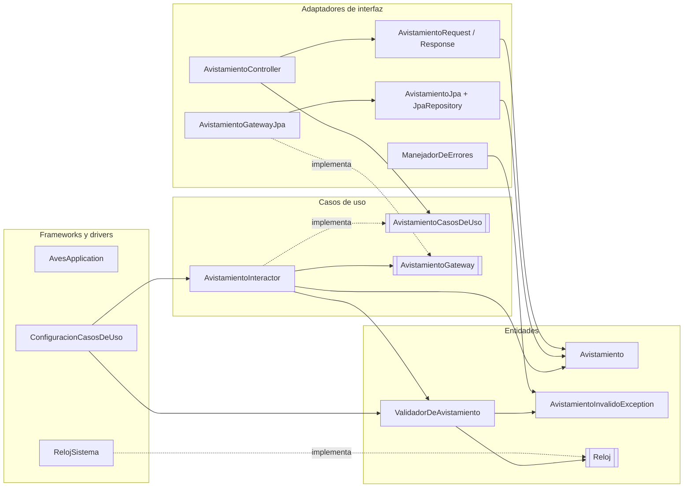

# Taller 5: Clean Architecture y arquitectura hexagonal

**Ingeniería de Software 2 (ISW-2)** · Miércoles 11 de noviembre de 2026  
**Autor:** Juan David Guarnizo Martinez

- **Repositorio:** https://github.com/Juanda210809/AvistamientoAves
- **Rama con los cambios:** `taller5-clean-architecture`
  (https://github.com/Juanda210809/AvistamientoAves/tree/taller5-clean-architecture)
- **Arquitectura elegida:** Clean Architecture (Martin, 2012)

---

## Parte 1. Investigación

### 1. El problema de Cockburn, puertos, adaptadores y la simetría

**El problema.** Lo que le molestaba a Cockburn era ver la lógica de negocio metida dentro del código de la interfaz de usuario. Según él, eso trae tres líos. Las pruebas automáticas se vuelven difíciles, porque la lógica queda pegada a detalles de pantalla que cambian a cada rato. Pasar a correr la aplicación por lotes, sin nadie sentado enfrente, deja de ser práctico. Y que otro programa la use se complica igual (Cockburn, 2005). Lo interesante es que él ve el mismo problema del otro lado: si la base de datos se cae o se cambia, el equipo se queda quieto, porque la lógica también está enredada con ella (Cockburn, 2005). Y meter una capa más no lo soluciona, ya que nada impide que la lógica se vuelva a colar en esa capa nueva (Cockburn, 2005).

**Puerto.** Es una entrada o salida de la aplicación, pero definida por el *propósito* de la conversación y no por la tecnología. En el código termina siendo una API, una interfaz, que la aplicación ofrece o que necesita de afuera (Cockburn, 2005). En mi caso serían cosas como "registrar un avistamiento" o "guardar y consultar avistamientos".

**Adaptador.** Es lo que conecta una tecnología concreta con un puerto y traduce de un lado al otro. Un mismo puerto puede tener varios: del lado del usuario, una interfaz gráfica, un arnés de pruebas o un script por lotes; del lado de los datos, uno con SQL, otro con archivos planos o uno en memoria para pruebas (Cockburn, 2005). Su ejemplo es un cálculo de descuentos en el que el repositorio de tasas se cambia por uno en memoria y el componente lo recibe por el constructor. Con eso se prueba sin pantalla y sin base de datos (Cockburn, 2005).

**La simetría.** Aquí está, creo, la idea más fuerte del artículo. Para Cockburn lo que importa no es izquierda contra derecha ni arriba contra abajo, como en las capas, sino **adentro contra afuera**: una aplicación en el centro que habla por varios puertos con lo que está fuera (Cockburn, 2005). Visto así, el usuario que maneja la aplicación y la base de datos que ella usa son casi lo mismo, actores externos conectados por un puerto y un adaptador. Cambia solo quién empieza la conversación: los actores *primarios* (usuario, pruebas, scripts) manejan la aplicación y a los *secundarios* (base de datos, servicio de notificaciones) los maneja ella (Cockburn, 2005). De ahí el hexágono. El seis no significa nada; la forma solo deja espacio para dibujar los puertos que hagan falta por cualquier lado (Cockburn, 2005).

### 2. Los círculos de Clean Architecture y la regla de dependencia

Martin dibuja cuatro círculos, uno dentro del otro (Martin, 2012):

| Círculo (de adentro hacia afuera) | Qué va ahí |
|---|---|
| **Entidades** | Las reglas de negocio más generales, las de la empresa. Pueden ser objetos con métodos o estructuras de datos con funciones. Casi no cambian y no les afecta, por ejemplo, un cambio en la navegación o en la seguridad. |
| **Casos de uso** | Las reglas propias de esta aplicación. Mueven los datos hacia las entidades y desde ellas, y les piden aplicar sus reglas. Cambian cuando cambia lo que hace la aplicación, no cuando cambia la base o la interfaz. |
| **Adaptadores de interfaz** | Pasan los datos del formato cómodo para los casos de uso al formato que pide lo externo (la web, la base de datos). Aquí quedan los controladores, presentadores y vistas de MVC y la conversión hacia la persistencia. |
| **Frameworks y drivers** | Lo de más afuera: la base de datos, el framework web y demás herramientas. Casi no hay código propio, apenas el "pegamento" que conecta con el círculo siguiente. |

Martin aclara que los cuatro círculos son un esquema. Puede haber más o menos, siempre que se respete la regla, y mientras más adentro, más abstracto es el código (Martin, 2012).

**La regla de dependencia.** Es corta: **las dependencias del código fuente solo pueden apuntar hacia adentro** (Martin, 2012). Lo que prohíbe es que algo de un círculo interior *nombre* cualquier cosa de uno exterior, ya sea una clase, una función o una variable. Tampoco deja que el círculo de adentro use formatos de datos inventados afuera, sobre todo los que genera un framework, para que un cambio externo no obligue a tocar el centro (Martin, 2012). Dicho de forma más simple: la entidad no sabe que existe el caso de uso, el caso de uso no sabe que existe el controlador y ninguno de los dos sabe que existen Spring o H2.

### 3. Cómo el caso de uso guarda datos sin depender de la base de datos

La contradicción es real. Cuando el programa corre, el control va **hacia afuera** (el caso de uso termina causando una escritura en la base), pero la regla dice que el código solo depende **hacia adentro**. ¿Cómo se arregla? Con el **principio de inversión de dependencias**. El círculo interior declara una interfaz con lo que necesita y el exterior la implementa, de modo que la flecha del código queda al revés del flujo de control (Martin, 2012). Martin lo muestra con el caso de uso que tiene que entregar resultados: no llama al presentador directamente, llama a una interfaz (un puerto de salida) que vive en el círculo de casos de uso, y el presentador de afuera la implementa (Martin, 2012). Con la persistencia pasa exactamente lo mismo. Es la "D" de SOLID que vimos en clase: el módulo de alto nivel y el de bajo nivel dependen los dos de una abstracción. Palermo describe el mismo truco con los repositorios, cuyas interfaces se definen en el núcleo mientras las implementaciones quedan en el borde y se inyectan al ejecutar (Palermo, 2008).

**Ejemplo con mi API (así quedó el código):**

```java
// Círculo de casos de uso: el caso de uso DEFINE lo que necesita.
package com.avistamientos.aves.usecases;
public interface AvistamientoGateway {
    Avistamiento guardar(Avistamiento avistamiento);
    Optional<Avistamiento> buscarPorId(Long id);
    // ...
}

public class AvistamientoInteractor implements AvistamientoCasosDeUso {
    private final AvistamientoGateway gateway;          // depende de la interfaz
    public Avistamiento crear(Avistamiento a) {
        validador.validar(a);
        a.setId(null);
        return gateway.guardar(a);                      // no sabe que hay JPA
    }
}

// Círculo de adaptadores: la IMPLEMENTA usando Spring Data JPA.
package com.avistamientos.aves.interfaceadapters.gateways;
@Component
public class AvistamientoGatewayJpa implements AvistamientoGateway {
    private final AvistamientoJpaRepository repo;
    public Avistamiento guardar(Avistamiento a) {
        return repo.save(AvistamientoJpa.desdeDominio(a)).haciaDominio();
    }
}
```

El control va `Interactor → Gateway → GatewayJpa → base de datos`. En el código, en cambio, quien importa es `AvistamientoGatewayJpa` (importa `usecases.AvistamientoGateway`), y `usecases` no importa nada de `interfaceadapters`. Spring, al arrancar, le pasa al interactor la implementación concreta. Hay un detalle más que pide Martin: lo que cruza la frontera es la entidad simple `Avistamiento` y no la fila de JPA (`AvistamientoJpa`). Si la fila llegara hasta el caso de uso, este quedaría amarrado al framework de persistencia (Martin, 2012).

### 4. Comparación: hexagonal, cebolla y Clean Architecture

**En qué se parecen.** Las tres ponen el negocio en el centro y mandan la tecnología (interfaz, base de datos, frameworks) al borde, como algo que se puede cambiar. Y las tres lo consiguen igual: interfaces que define el núcleo y que se implementan afuera, o sea, inversión de dependencias (Cockburn, 2005; Palermo, 2008; Martin, 2012). La meta también coincide, probar la lógica sin interfaz ni base de datos y poder cambiar esos detalles sin tocar el negocio. El propio Martin dice que su artículo intenta juntar varias de estas arquitecturas, entre ellas la hexagonal y la de cebolla, y que aunque difieren en detalles se parecen mucho (Martin, 2012). Palermo, por su parte, reconoce que comparte con Cockburn la premisa de sacar la infraestructura y conectarla con adaptadores (Palermo, 2008).

**Qué cambia:**

| | Hexagonal (Cockburn, 2005) | Cebolla (Palermo, 2008) | Clean Architecture (Martin, 2012) |
|---|---|---|---|
| Idea central | Adentro vs. afuera, unidos por puertos | Anillos concéntricos; el acoplamiento va hacia el centro | Círculos concéntricos y una sola regla de dependencia |
| Capas | **No define capas internas.** Solo "la aplicación" y lo de afuera | Modelo de dominio en el centro, luego servicios de dominio y de aplicación; afuera UI, infraestructura y pruebas. Los anillos pueden variar | Cuatro círculos con nombre (entidades, casos de uso, adaptadores, frameworks), pero "esquemáticos" |
| Vocabulario | Puerto, adaptador, actor primario y secundario | Modelo de dominio, interfaz de repositorio, servicios, infraestructura | Entidad, caso de uso o *interactor*, puerto de entrada y de salida, *gateway*, controlador, presentador |
| En qué insiste | La **simetría**: usuario y base de datos se tratan igual; las pruebas son un actor más | La **base de datos no es el centro**, se trata como algo externo; muy orientada a objetos | La **dirección de las dependencias** en todo el sistema y qué datos cruzan cada frontera |
| Interior del núcleo | No dice nada | Separa dominio de servicios | Separa reglas de la empresa (entidades) de reglas de la aplicación (casos de uso) |

Mi lectura es que la diferencia va más allá del vocabulario. La hexagonal se ocupa de la **frontera** de la aplicación y no dice cómo organizar lo de adentro (Cockburn, 2005), mientras que la cebolla y Clean sí proponen capas dentro del núcleo (Palermo, 2008; Martin, 2012). Clean, eso sí, va un paso más allá: reduce todo a una regla que se puede verificar, separa reglas de empresa y de aplicación, y se pregunta qué formato de datos puede pasar por cada frontera (Martin, 2012).

### 5. ¿Se justifica Clean Architecture en una API tan pequeña?

**Mi posición:** completa, como si fuera un sistema grande, **no se justifica** para esta API. Lo que **sí vale la pena** es la parte central: tener el validador, la entidad y los casos de uso sin Spring ni JPA, y que el caso de uso dependa de una interfaz de repositorio que él mismo define. La apliqué entera porque el taller lo pedía, y la verdad es que así se ven mucho mejor los costos.

**Un costo concreto.** El código de producción pasó de 11 a 18 clases para hacer exactamente lo mismo. Ahora un avistamiento existe en cuatro formas: `AvistamientoRequest` (el JSON que entra), `Avistamiento` (el dominio), `AvistamientoJpa` (la fila de la base) y `AvistamientoResponse` (el JSON que sale), con métodos para pasar de una a otra (`haciaDominio`, `desdeDominio`, `desde`). Si mañana quiero agregar un campo, digamos "cantidad de aves", toca cambiar cinco archivos y no uno. Palermo lo dice sin rodeos: su arquitectura sirve para aplicaciones de negocio que van a durar años y tienen comportamiento complejo, no para sitios web pequeños (Palermo, 2008). Con 6 endpoints y una sola regla de validación, mi API cae del segundo lado.

**Un beneficio concreto.** El caso de uso ya no conoce `JpaRepository`. Antes, la prueba unitaria del servicio tenía que simular métodos de Spring Data (`findById`, `existsById`, `save`). Ahora simula `AvistamientoGateway`, una interfaz de cinco métodos con nombres del dominio que controlo yo. Es justo lo que buscan Cockburn y Martin, poder probar la lógica sin la base de datos ni el framework web (Cockburn, 2005; Martin, 2012). Si un día cambio H2 por PostgreSQL, o JPA por JDBC, escribo otro adaptador y el interactor y el validador ni se enteran. Y como la regla de dependencia es mecánica, la pude volver una prueba (`ReglaDeDependenciaTest`) que falla si alguien importa Spring desde las entidades o los casos de uso.

A fin de cuentas, lo que más aporta (núcleo sin framework y el repositorio como puerto) sale barato; lo caro son los DTO y las conversiones en cada frontera. En una API de este tamaño yo me quedaría con lo primero y dejaría lo segundo para cuando crezca o tenga más de un cliente. Ahora, si la API fuera a vivir años o a llenarse de reglas, ese costo inicial se pagaría solo.

---

## Parte 2. Aplicación

### Arquitectura elegida

Elegí **Clean Architecture (Martin, 2012)**. Los paquetes se llaman como los cuatro círculos de Martin y las clases usan su vocabulario (entidad, interactor, puerto de entrada, *gateway*, controlador). Evité a propósito nombres de las otras dos, como `ports`/`adapters` o `domain`/`infrastructure`, para no terminar con una mezcla.

### Estructura de carpetas

Antes, el código estaba organizado alrededor del framework:

```
com.avistamientos.aves
├── AvesApplication.java, ServletInitializer.java
├── model/Avistamiento.java            @Entity de JPA, usado también como JSON
├── validacion/                        Validador, Reloj, RelojSistema, excepción, manejador 400
├── repository/AvistamientoRepository  JpaRepository
├── service/AvistamientoService        @Service, dependía de JpaRepository
└── controller/AvistamientoController  @RestController
```

Así quedó con Clean Architecture:

```
avistamiento_aves/src/main/java/com/avistamientos/aves
├── AvesApplication.java                 Main (círculo de frameworks y drivers)
├── ServletInitializer.java              Main para desplegar el .war
│
├── entities/                            ── Círculo 1: ENTIDADES (reglas de negocio)
│   ├── Avistamiento.java                   clase normal, sin JPA ni Spring
│   ├── ValidadorDeAvistamiento.java        regla: especie de 3 a 50, fecha válida y no futura, campos obligatorios
│   ├── AvistamientoInvalidoException.java
│   └── Reloj.java                          interfaz: "qué día es hoy"
│
├── usecases/                            ── Círculo 2: CASOS DE USO
│   ├── AvistamientoCasosDeUso.java         puerto de entrada (lo usa el controlador)
│   ├── AvistamientoInteractor.java         listar, buscar, crear, actualizar, eliminar, resumen
│   └── AvistamientoGateway.java            puerto de salida (interfaz de persistencia definida aquí)
│
├── interfaceadapters/                   ── Círculo 3: ADAPTADORES DE INTERFAZ
│   ├── controllers/
│   │   ├── AvistamientoController.java     REST /avistamientos, llama al puerto de entrada
│   │   ├── AvistamientoRequest.java        JSON de entrada → entidad
│   │   ├── AvistamientoResponse.java       entidad → JSON de salida
│   │   └── ManejadorDeErrores.java         AvistamientoInvalidoException → 400 {"campo","error"}
│   └── gateways/
│       ├── AvistamientoGatewayJpa.java     implementa AvistamientoGateway
│       ├── AvistamientoJpa.java            @Entity (fila de la tabla "avistamiento") y conversión
│       └── AvistamientoJpaRepository.java  Spring Data
│
└── frameworks/                          ── Círculo 4: FRAMEWORKS Y DRIVERS
    ├── ConfiguracionCasosDeUso.java        @Configuration: crea el validador y el interactor
    └── RelojSistema.java                   implementa Reloj con LocalDate.now()

src/test/java/com/avistamientos/aves
├── entities/ValidadorDeAvistamientoTest.java, RelojFijo.java     unitarias (14)
├── usecases/AvistamientoInteractorTest.java                      unitarias con Mockito (8)
├── integracion/AvistamientoApiIntegracionTest.java               integración MockMvc + H2 (14)
├── arquitectura/ReglaDeDependenciaTest.java                      revisa la regla de dependencia (3, nueva)
└── AvesApplicationTests.java                                     contexto de Spring (1)
```

Algunas decisiones que tomé por el camino. Las entidades y los casos de uso quedaron **sin ninguna anotación de Spring**: antes `ValidadorDeAvistamiento` era `@Component` y el servicio era `@Service`, y ahora los dos se crean en `frameworks/ConfiguracionCasosDeUso`, que es el único lugar que conoce el núcleo y sus implementaciones a la vez (lo que Martin llama el "Main").

`Reloj` lo dejé en entidades porque lo necesita la regla de la fecha, y esa es una regla de negocio. Su implementación con el reloj del sistema (`RelojSistema`) sí es un detalle, así que quedó afuera.

La entidad del dominio y la de JPA ahora son clases distintas. `AvistamientoJpa` mantiene el nombre de tabla `avistamiento` con `@Table` para no perder lo que ya había guardado en `data/`.

Por último, Spring Web y Spring Data solo aparecen en los adaptadores, como herramientas para el pegamento (`@RestController`, `JpaRepository`). Entre mis propios círculos la regla se cumple: `interfaceadapters` no importa nada de `frameworks`, `usecases` solo importa `entities` y `entities` solo importa `java.time`.

### Diagrama de dependencias


La misma idea en Mermaid (GitHub lo dibuja):



Para comprobarlo revisé con `grep` qué importa cada círculo después del refactor:

```
== entities importa:          java.time, java.time.format
== usecases importa:          com.avistamientos.aves.entities, java.util, java.util.stream
== interfaceadapters importa: com.avistamientos.aves.entities, com.avistamientos.aves.usecases,
                              jakarta.persistence, java.util, org.springframework.(data|http|stereotype|web)
== frameworks importa:        com.avistamientos.aves.entities, com.avistamientos.aves.usecases,
                              java.time, org.springframework.(context|stereotype)
```

### Commits del refactor

| Commit | Qué hace |
|---|---|
| `Taller 5: guarda evidencia ... antes del refactor` | Salida de las pruebas, reporte JaCoCo y respuestas de la API con el código original. |
| `Refactor 1/5` | Mueve las reglas de negocio (validador, `Reloj`, excepción) a `entities`; `RelojSistema` a `frameworks`; `ManejadorDeErrores` a `interfaceadapters/controllers`. |
| `Refactor 2/5` | Crea los casos de uso: `AvistamientoInteractor` (antes `AvistamientoService`), el puerto de entrada, el puerto de salida `AvistamientoGateway`, su adaptador JPA y la configuración que los conecta. |
| `Refactor 3/5` | Separa `entities/Avistamiento` (clase normal) de `AvistamientoJpa` (fila de la base). |
| `Refactor 4/5` | Pasa el controlador a `interfaceadapters/controllers` con `AvistamientoRequest` y `AvistamientoResponse`. |
| `Refactor 5/5` | Agrega `ReglaDeDependenciaTest` y quita métodos que no se usaban en `AvistamientoJpa`. |
| `Taller 5: documento` | Este documento, las imágenes y la evidencia del después. |
| `Taller 5: ajusta redacción` | Repaso de la redacción del documento y de los comentarios del código. |

Después de cada commit corrí `mvn test` y las pruebas siguieron pasando.

### Evidencia de funcionamiento y cobertura

Los comandos que usé, desde `avistamiento_aves/`:

```bash
./mvnw clean verify                        # pruebas + reporte JaCoCo en target/site/jacoco/index.html
java -jar target/aves-0.0.1-SNAPSHOT.war   # levantar la API con una base vacía
bash ../docs/taller5/probar_api.sh         # la misma secuencia de 14 peticiones, antes y después
```

#### Antes del refactor

Pruebas: **37, ninguna falla, BUILD SUCCESS.**


Cobertura (JaCoCo):


Respuestas de la API:


#### Después del refactor

Pruebas: **40 (las 37 de antes más 3 de arquitectura), ninguna falla, BUILD SUCCESS.**


Cobertura (JaCoCo):


Respuestas de la API:


#### Comparación

| | Antes | Después |
|---|---|---|
| Pruebas | 37 pasan, 0 fallan | 40 pasan, 0 fallan (las mismas 37 + 3 nuevas) |
| Cobertura de instrucciones | 94,9 % (315/332) | 96,9 % (530/547) |
| Cobertura de ramas | 86,4 % (19/22) | 86,4 % (19/22) |
| Cobertura de líneas | 95,7 % (90/94) | 97,3 % (146/150) |
| Lo que no se cubre | El `main` de `AvesApplication` y `ServletInitializer` (arranque) y 3 ramas del validador (`null` en especie y fecha) | Lo mismo; ninguna clase perdió cobertura |
| Clases de producción | 11 | 18 |

Si se dejan por fuera las dos clases de arranque, las líneas cubiertas son el 100 % antes y después.

**La API responde igual.** Guardé las 14 respuestas (código HTTP y cuerpo) en `evidencia/antes/api_respuestas.txt` y `evidencia/despues/api_respuestas.txt`, y `diff` no encuentra ni una diferencia, ni siquiera en el orden de los campos del JSON:


**Qué cambié en las pruebas.** La lógica de las 37 es la misma: mismos casos, mismos datos, mismos `assert`. Solo toqué lo que el refactor obligaba. `ValidadorDeAvistamientoTest` y `RelojFijo` cambiaron de paquete (`validacion` → `entities`). `AvistamientoServiceTest` pasó a llamarse `AvistamientoInteractorTest` y ahora el doble de Mockito es de `AvistamientoGateway` en vez de `AvistamientoRepository`, por eso `findById`, `save`, `existsById`, `deleteById` y `findAll` se volvieron `buscarPorId`, `guardar`, `existe`, `eliminar` y `listarTodos`. En `AvistamientoApiIntegracionTest` los datos de prueba se siembran con `AvistamientoJpa` y `AvistamientoJpaRepository`; esa prueba está afuera de todos los círculos, así que puede usar la base directamente. Las peticiones HTTP y lo que se verifica quedaron intactos.

Los archivos completos están en `docs/taller5/evidencia/antes/` y `docs/taller5/evidencia/despues/`: la salida de `mvn verify`, el reporte JaCoCo en HTML y CSV, y las respuestas de la API.

### Lo más difícil de separar y por qué

Sin duda, **la clase `Avistamiento`**. En el código original una sola clase hacía tres trabajos: era la `@Entity` de JPA (con `@Id` y `@GeneratedValue`), era el JSON que recibía y devolvía el controlador y era el objeto que pasaba por la regla de negocio. La usaban todas las capas y las tres clases de pruebas. Para cumplir la regla de dependencia tuve que partirla en cuatro (`Avistamiento`, `AvistamientoJpa`, `AvistamientoRequest`, `AvistamientoResponse`) y escribir las conversiones. Ahí había tres cosas que podían romper la API sin que me diera cuenta.

La primera fue el nombre de la tabla. Al renombrar la entidad JPA, Hibernate habría creado otra tabla (`avistamiento_jpa`) y los datos de `data/` se habrían "perdido". Lo arreglé con `@Table(name = "avistamiento")`.

La segunda, que el JSON saliera idéntico, con los mismos campos y en el mismo orden. Para no depender de cómo Jackson ordena los componentes de un `record`, hice `AvistamientoResponse` como clase con getters (igual que la entidad original) y comprobé con `diff` que la salida fuera la misma byte por byte.

La tercera fue el `id` que asigna la base. Antes `repo.save(a)` modificaba el mismo objeto. Ahora el adaptador convierte a fila, guarda y convierte de vuelta, así que el caso de uso tiene que usar el objeto que le devuelve `guardar(...)` y no el que mandó.

Lo otro que costó fue **sacar Spring del núcleo**. El validador y el servicio funcionaban porque Spring los encontraba gracias a `@Component` y `@Service`. Si solo quitaba esas anotaciones, Spring ya no encontraba esos objetos y la aplicación no arrancaba; por eso creé `ConfiguracionCasosDeUso` en el círculo de frameworks, que los construye a mano. También dudé dónde poner `Reloj`. Es una interfaz técnica, pero la necesita una regla de negocio (la fecha no puede ser futura), así que la dejé en entidades y su implementación con el reloj del sistema afuera.

---

## Uso de IA

Usé Claude (Anthropic) como herramienta de apoyo durante el taller: para ordenar los pasos del refactor, revisar que las pruebas siguieran pasando, generar las capturas y el diagrama, y revisar la redacción. Leí las fuentes citadas y revisé el código; entiendo qué hace cada círculo y por qué las dependencias apuntan hacia adentro.

---

## Referencias

- Cockburn, A. (2005). *Hexagonal architecture* (Ports and Adapters). Alistair Cockburn. https://alistair.cockburn.us/hexagonal-architecture/ (secciones Intent, Motivation y Nature of the solution).
- Martin, R. C. (2012, 13 de agosto). *The Clean Architecture*. The Clean Code Blog. https://blog.cleancoder.com/uncle-bob/2012/08/13/the-clean-architecture.html
- Palermo, J. (2008, julio). *The Onion Architecture: part 1*. Jeffrey Palermo (blog). https://jeffreypalermo.com/2008/07/the-onion-architecture-part-1/
